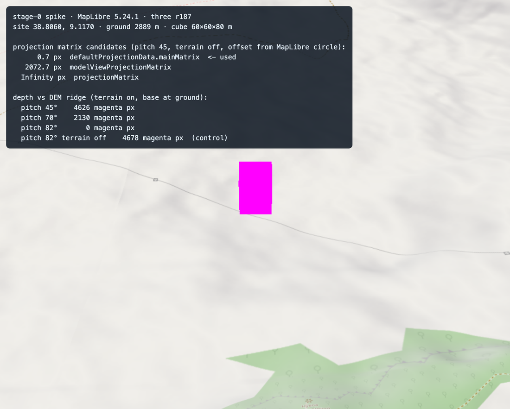
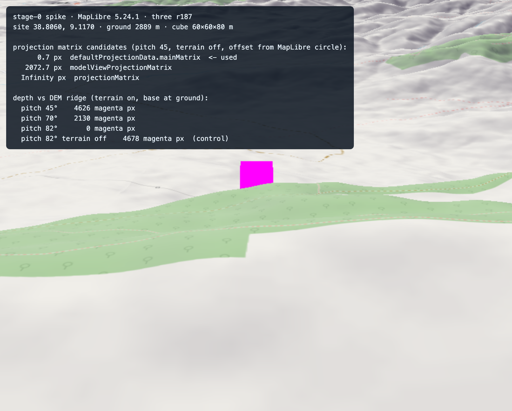

# Stage 0 spike — a three.js layer on the MapLibre map

Status: **done**, 25 November 2026, against MapLibre GL JS **5.24.1** and three.js **r187** (the versions
locked in `frontend/package-lock.json`). This settles the open questions in
[`3d-georeferenced-layer-plan.md`](3d-georeferenced-layer-plan.md) §5.4 and §7 stage 0.

The spike is a throwaway page (`spike-stage0/index.html` in the chat workspace, libs copied from
`frontend/node_modules`). It renders a 60 × 60 × 80 m magenta cube through a `CustomLayerInterface`
at a known coordinate, draws a MapLibre circle at the same coordinate as ground truth, and reads the
frame back with `gl.readPixels` so every claim below is a pixel count, not an impression.

## 1. Which matrix the layer must use

MapLibre 5.24.1 hands a custom layer this object (`drawCustom`, `maplibre-gl-dev.js`):

```js
{ farZ, nearZ, fov,
  modelViewProjectionMatrix,     // transform.modelViewProjectionMatrix
  projectionMatrix,              // transform.projectionMatrix   <- NOT the one
  shaderData,
  defaultProjectionData: { mainMatrix, tileMercatorCoords, clippingPlane,
                           projectionTransition, fallbackMatrix } }
```

`defaultProjectionData` has **no `projectionMatrix` member** in 5.24.1; the plan's draft snippet
referenced one that does not exist.

Measured at pitch 45°, zoom 16, terrain off, cube anchored with `MercatorCoordinate.fromLngLat`, and
compared with the screen position MapLibre itself draws a circle at for the same lng/lat:

| Candidate | Offset of the cube's base from MapLibre's circle | Verdict |
|---|---|---|
| `args.defaultProjectionData.mainMatrix` | **0.3–0.7 px** | correct: mercator world → clip |
| `args.modelViewProjectionMatrix` | 2 072 px | wrong: already includes the map's own model matrix, so the cube is transformed twice |
| `args.projectionMatrix` | unbounded (`w = 0`) | wrong: it is the view-space perspective matrix; its w row is `[0, 0, −1, 0]`, so a mercator world point (z ≈ 0) lands on the w = 0 plane |

Against the same frame, the cube's rendered centroid was **1.0 px** from the position predicted by
`mainMatrix` × `modelMatrix`, and its magenta area was 4 678 px — so the matrix, the model matrix and
the draw call all agree.

**Decision: use `args.defaultProjectionData.mainMatrix` as `camera.projectionMatrix`,** with the
`modelMatrix` built from `MercatorCoordinate.fromLngLat` + `meterInMercatorCoordinateUnits()` as the
plan describes. This corrects the plan's §5.4 snippet and its note about which member to confirm.

## 2. The cube at a known coordinate

Site: `38.8060, 9.1170`, the floor of the basin north of the Entoto ridge (ground 2 888.6 m by
`map.queryTerrainElevation`). The cube is 60 × 60 × 80 m, base at the anchor, `modelMatrix` from
§5.3 of the plan with rotation 0 and scale 1.

At zoom 16, pitch 45°, terrain off, the cube's base landed 0.7 px from the MapLibre circle at the
same lng/lat and its centroid 1.0 px from the predicted point — well inside the 1 cm/1 px target of
plan §8.1 and §8.4.

## 3. Depth against a DEM hill

The ridge behind the site is real: `38.8060, 9.1095` is 3 177 m, the site 833 m north is 2 889 m
(DEM profile computed from the same Terrarium tiles the map uses). With terrain on and the cube's
base on the ground at zoom 16, the magenta pixel count in the rendered frame was:

| Camera pitch | Magenta px | Opaque px in frame | Meaning |
|---|---|---|---|
| 45° | 4 626 | 555 776 (full) | visible on the slope |
| 70° | 2 130 | 555 776 (full) | base cut off by the ridge |
| 82° (MapLibre clamps to 78.4°) | **0** | 555 776 (full) | fully hidden behind the hill |
| 82°, terrain off, cube on the flat z = 0 plane | 4 678 | — | renderer fine at this pitch — the hill is what hid it |

So **custom layers are depth-tested against the DEM**: keeping MapLibre's depth buffer (no clear,
`autoClear = false`, `renderingMode: '3d'` → `LEQUAL` read/write) is sufficient, and a building
behind a ridge disappears correctly. No depth tricks, no manual depth queries.




Four things worth knowing before stage 1:

* Every measurement records the number of opaque pixels in the frame. Early runs produced all-zero
  readbacks with a fully transparent frame — a blank frame looks exactly like "fully occluded", so
  the probe now refuses to call a pitch occluded unless the frame is fully opaque. Stage 1's test
  harness should do the same.
* MapLibre clamps pitch over terrain — asking for 82° gave 78.4°. Use the *actual* `map.getPitch()`.
* At zoom 17 the same camera is pushed up to stay above the terrain and the ridge no longer
  occludes at all (20 122 / 14 051 / 16 390 magenta px at 45/70/82). Occlusion depends on camera
  height above the hill, so the depth test must fix zoom, pitch and site together.
* With `preserveDrawingBuffer: false`, `gl.readPixels` still works inside the custom layer's
  `render` (which is what the probe uses), but `canvas.toDataURL()` and some headless screenshots
  come back empty. Set `preserveDrawingBuffer: true` while developing the layer.

## 4. Limits of this spike

* Software GL in the cloud browser: frame times are seconds, not the 60 fps target; nothing here is
  a performance measurement. It also produces occasional empty frames, which is why the probe checks
  opacity.
* One model, no rotation, no scale, no convergence — those are stage 1 and still need the fixture
  test in plan §8.1.
* The spike page is throwaway; the numbers above are the deliverable, not the page.

## 5. What changes in the plan

1. §5.4: use `args.defaultProjectionData.mainMatrix` (not `args.projectionMatrix`, and not a
   `defaultProjectionData.projectionMatrix`, which does not exist in 5.24.1).
2. §7 stage 0 is complete; stage 1 can start on these foundations.
3. §8.4 stays as written — the circle/`map.project()` comparison is the test that caught the wrong
   matrix here.
