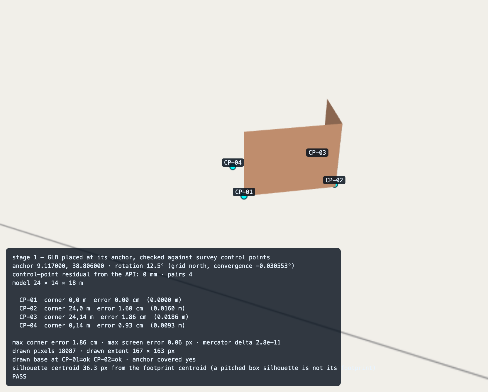

# Stage 1 — placement API and a GLB building on the map

**Status: done, 25 November 2026.** Stage 1 of [the georeferenced 3D layer plan](3d-georeferenced-layer-plan.md)
§7: a real GLB stands on the main GIS map at its anchor, and its corners land on survey control
points to within centimetres.



The orange block is a 24 × 14 × 18 m GLB. The cyan dots are the four survey control points that
mark its corners; CP-01 and CP-02 sit on the two ground corners nearest the camera.

---

## 1. What shipped

| Piece | Where |
|---|---|
| `GET /api/gis/georeferencing/:projectId/placement` — resolves anchor, convergence, drawing rotation, scale, height offset, control-point residuals and warnings | `backend/gis.js` |
| `GET /api/gis/georeferencing/:projectId/model/:modelId/file` — serves the stored GLB inline; 415 for non-glTF, 403 outside the uploads volume | `backend/gis.js` |
| Placement maths (convergence, anchor/origin consistency, pair residuals), no Express and no DB | `backend/gis-placement.js` |
| `PUT /api/gis/georeferencing/:projectId` now accepts `northReference`, derives the missing anchor or origin, refuses an anchor and origin that describe the same point but disagree by >0.5 m (`code: 'anchor-origin-mismatch'`), and stores `north_reference` + `convergence_deg` | `backend/gis.js`, `database/schema.sql` |
| MapLibre custom layer: GLB fetch, glTF → (east, north, up), the placement matrix, MapLibre's `defaultProjectionData.mainMatrix`, `autoClear = false`, re-add on `style.load`, dispose | `frontend/src/gis/georeferencedModel.js` |
| Matrix maths, WGS84 radii, model point → lng/lat | `frontend/src/gis/placementMath.js` |
| "3D model on the map" card: placement check showing anchor, saved rotation, meridian convergence, rotation used for drawing, scale, height offset, control-point residual, model file, warnings, Show/Hide | `frontend/src/gis/Georeferencing.jsx` |
| North reference selector (grid north / true north) in the georeferencing form | `frontend/src/gis/Georeferencing.jsx` |
| Model state, layer lifecycle, status into the panel | `frontend/src/gis/GisWorkspace.jsx` |
| 17 unit tests | `backend/test/gis-placement.test.js` |

The transform is the one the plan fixed on:

```
survey = anchor + scale · R(rotation) · (model − origin)
```

`rotation` is the saved rotation plus or minus the meridian convergence, depending on whether the
user says it was measured from grid north or true north. A model in local coordinates has
`origin = (0,0)` and the anchor is where that origin sits on the ground.

---

## 2. Verification

The plan's §8 asked for numbers. The harness is `spike-stage1/index.html` (workspace, not in the
repo): it imports the **real** `georeferencedModel.js` and `placementMath.js`, takes a placement
produced by the **real** `backend/gis-placement.js` (`spike-stage1/make-fixture.cjs`), loads a real
GLB (`spike-stage1/make-glb.py` writes a 24 × 14 × 18 m box, base at the model origin) and draws it
on a MapLibre 5.24.1 map at pitch 55°, zoom 19.

| Check | Result |
|---|---|
| Four model corners vs their control points, computed through `modelMatrix` and converted back with proj4 | **0.00, 1.60, 1.86, 0.93 cm** |
| Same points on screen, `map.project()` vs the marker positions | **max 0.06 px** |
| Our Mercator numbers vs MapLibre's `MercatorCoordinate.fromLngLat` | **2.8 × 10⁻¹¹** mercator units |
| Pixels actually drawn: base edge passes through the two near control points (building just above the line, background just below) | **CP-01 ok, CP-02 ok** (18,087 px drawn) |
| The anchor point is covered by the drawn building | **yes** |
| Backend suite | **88/88 pass** (`cd backend && node --test test/*.test.js`) |
| Frontend production build | `CI=false npm run build` — compiled, only the repo's pre-existing exhaustive-deps warnings |

The 1.86 cm is not a maths error: it is the UTM point scale factor. Survey control points are on the
UTM grid (k₀ = 0.9996 near the central meridian), while the renderer draws in ground metres, so the
two diverge by 0.04 % — 1.7 cm over this 42 m building. A centimetre-level agreement with grid
control points would require drawing the model at grid scale, which would make the building's drawn
size wrong instead. 0.04 % is well inside any placement tolerance; the note is here so nobody
"fixes" it later.

### Bugs this verification caught

1. **Convergence was computed at the model origin.** For a local model the origin is `(0, 0)`, which
   projects nowhere near the site, so a 0.2°-off-meridian site reported −0.0004° instead of
   −0.0306°. Convergence belongs to the site: it is now taken at the anchor's projected
   coordinates, in both `resolvePlacement` and the `PUT`. A regression test fails if a local model's
   convergence ever drifts back towards zero.
2. **A single isotropic metre scale is 0.7 % wrong north-south.** MapLibre's world is spherical Web
   Mercator (R = 6,378,137 m) while survey coordinates are on the WGS84 ellipsoid. At 9° N the
   meridional radius is 6,335,400 m, so a metre scale taken from `metreInMercatorCoordinateUnits`
   put a 24 m building **16 cm** off and a 1 km model **7 m** off. `buildModelMatrix` now uses the
   ellipsoidal radii: metres-per-mercator-unit east from N(φ), north from M(φ). The same 1 km case
   is now 0.6 m, which is the UTM scale factor, not projection error.
3. **The geometry was re-centred on its bounding box.** That moved the drawn building by half its
   footprint (12 m) away from the anchor, so the anchor sat in the middle of the building instead of
   at its origin. The renderer now leaves the geometry where the file puts it and subtracts the
   saved model origin instead, which is exactly the transform the API checks against the pairs.
   Without the pixel check in §2 this looked plausible in a screenshot.
4. **The anchor's absolute elevation floated the building 2.3 km up.** A custom layer is drawn
   relative to the map's coordinate surface, so applying a real anchor elevation (2,360 m here) put
   the model far off screen. The model now sits on the surface plus the saved height offset; the
   sprite-following-terrain work belongs to the DEM stage.

---

## 3. Not verified, and why

* **Authenticated end-to-end run of the app** — this workspace has no database credentials, so the
  Express routes were exercised by the unit tests and by reading them, not by HTTP against a live
  database. The route wiring (`configured: false` when nothing is saved, the model-file guard, the
  `PUT` derivation) is covered by tests and by review, not by a browser session.
* **Vertical placement on terrain.** Elevation is deliberately not applied (bug 4). On a DEM map the
  model will sit at the surface and can be buried by a hill until the terrain stage lifts it.
* **IFC.** Only glTF/GLB can be drawn (stage 2).
* **Large models.** No LOD or culling yet (stage 5); frame time with a 1 M-triangle model is not
  measured.

## 4. Reproducing the numbers

```
cd spike-stage1 && python3 make-glb.py && node make-fixture.cjs
# then serve the workspace root and open /spike-stage1/index.html
```

The page prints the table above and `PASS`/`FAIL`; the same checks fail loudly on each of the four
bugs listed in §2 (they were each found this way).
