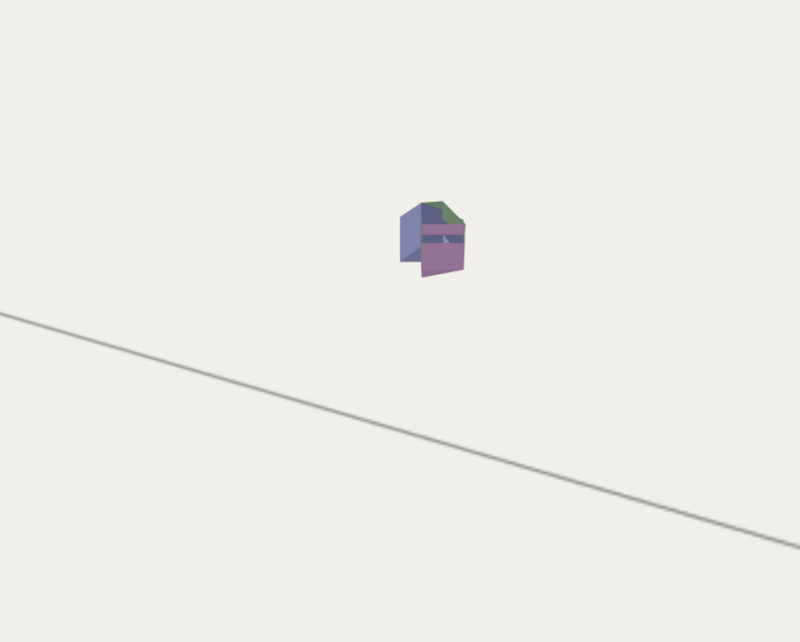

# Stage 2 — a small IFC drawn on the map, no conversion

**Status: done, 25 November 2026.** Stage 2 of [the georeferenced 3D layer plan](3d-georeferenced-layer-plan.md)
§7: an IFC of up to 25 MB is parsed in the browser with the BIM viewer's own geometry extraction and
drawn at its surveyed anchor. Larger files are refused before the download, with the server
conversion stage named as the way forward.



The purple and green elements are an IFC4 building — slabs, walls, a spatial zone and a proxy —
drawn by the map layer with no GLB export and no server conversion.

---

## 1. What shipped

| Piece | Where |
|---|---|
| IFC geometry extraction, shared by the BIM viewer and the map layer: placed triangles, colour per IFC class, length unit, storeys, per-element extents | `frontend/src/bim/ifcGeometry.js` (new) |
| The BIM viewer now builds its triangles through that shared helper instead of its own copy | `frontend/src/BimViewer.jsx` |
| IFC read in the browser for the map: download, size gate, web-ifc `OpenModel` with `COORDINATE_TO_ORIGIN`, geometry, counts, dispose | `frontend/src/gis/ifcModel.js` (new) |
| The layer picks glTF or IFC from the API's description and refuses with the API's reason | `frontend/src/gis/georeferencedModel.js` |
| `describeModelForMap`: format, renderer, size, the 25 MB limit and the message for a model too large to draw — decided on the server, unit-tested | `backend/gis-placement.js` |
| `/placement` reports the model's size on disk and its `mapSupport` | `backend/gis.js` |
| The model-file route serves `.ifc` as `application/x-step` (other types still 415) | `backend/gis.js` |
| Georeferencing panel: "How it is drawn" (IFC read in the browser / glTF, with size), the reason shown and Show disabled when a model cannot be drawn | `frontend/src/gis/Georeferencing.jsx` |
| 6 new tests on the format gate (GLB, IFC at the limit, IFC over it, unknown size, unsupported types, no model) | `backend/test/gis-placement.test.js` |

The split of responsibility: the **server** decides what can be drawn and says why not; the
**browser** only draws. That keeps the 25 MB rule in one place, so the "large model" path cannot
drift between the panel, the renderer and the API.

---

## 2. Verification

Two harnesses, both using the real modules, not re-implementations:

**Numeric, no browser** (`spike-stage2/check-ifc.mjs`, Node + web-ifc + the shared extraction):

| Check | Result |
|---|---|
| `building-ifc4.ifc` (139 KB) parses | IFC4, 12 elements, 12 meshes, 1 storey |
| Geometry arrives in **metres**, though the file declares millimetres | the file's slab point list spans 5200 × 5800 × 250 mm; a mesh measures **0.25 m** against the 250 mm span — 0 mm difference |
| Placement of that geometry against two control points (origin and 10 m grid-east) | **0.67 cm max** at 10 m |
| Format gate boundaries | 25 MB → drawable; 25 MB + 1 byte → refused with the stage-3 message; 80 MB GLB → drawable |

**In the browser** (`spike-stage2/index.html`, MapLibre 5.24.1 at a plan view so each element's
silhouette is its footprint; the pixels are a before/after diff of the canvas):

| Check | Result |
|---|---|
| The layer reports the IFC | "IFC read: 12 elements, 12 meshes, 1 storeys · 38.54 × 7 × 24.29 m (IFC4, declared in millimetres)" |
| Pixels the GPU drew | 247 |
| Those pixels inside the plan extent the placement predicts | **99.6 %** (246 / 247) — nothing is drawn where the placement does not put it |
| Elements covering more than 2 m² of plan, with pixels inside their own predicted footprint | **3 / 3** (slab 120 px, slab 33 px, slab 38 px, spatial zone 204 px, proxy 142 px) |
| Elements with any pixels at all | 9 / 12 — the three missing are a 0.2 m wall seen edge-on, a 1 m box under a slab, and a 1.63 × 0.1 m sliver; a plan view hides them legitimately |
| A 30 MB IFC | refused before any download, reason shown, Show button withheld |
| Backend suite | **94 / 94** (`cd backend && node --test test/*.test.js`) |
| Frontend production build | `CI=false npm run build` — compiled, only the repo's pre-existing exhaustive-deps warnings |

### The bug this verification caught

**The length unit was applied twice.** web-ifc hands back geometry already converted to metres —
the fixture declares millimetres and writes a 250 mm slab, and the vertex data for it comes back
as 0.25. Scaling by the declared unit as well drew a 25 m building 2.5 cm wide: invisible below
zoom 22, and the first browser run showed 0 drawn pixels because of it. The layer no longer scales;
the declared unit is still reported, because it is what the file says. The check above asserts the
0.25 m / 250 mm equality so this cannot come back silently.

A second, smaller thing the same harness produced: **per-element extents** (`elementBoxes`) are now
part of the extraction. They made the pixel-per-element check possible, and stage 4's storey and
section filters need them anyway.

---

## 3. Not verified, and why

* **A real project end-to-end.** No database credentials in this workspace, so the route changes
  (the size lookup, serving `.ifc`) are covered by unit tests and review, not by an HTTP session
  against a live database.
* **A large IFC's behaviour.** Nothing above 139 KB was parsed. The 25 MB limit is a policy, not a
  measured freeze point; the freeze point is what stage 5's performance work should measure.
* **IFC files whose geometry sits at real site coordinates.** `COORDINATE_TO_ORIGIN` keeps the
  file's own origin, but the panel's model coordinates are then in that translated frame. A file
  carrying UTM coordinates in its own placements needs a check of its own before it is trusted.
* **Terrain.** Models still sit on the map surface, not on the DEM (unchanged from stage 1).
* **Selection and storey filters on the map** — stage 4.

## 4. Follow-up worth doing next time the BIM screen is touched

`BimViewer` still multiplies its reported sizes and its measure distances by its own `unitScale`
(0.001 for a millimetre file). Given the measurement above, web-ifc has already converted those
numbers, so that multiplication makes the viewer's sizes and measurements a thousand times too
small for millimetre IFCs. It was left alone here because stage 2 shares only the geometry
extraction, and changing the viewer's measurements without testing that screen would be a guess
dressed as a fix.

## 5. Reproducing the numbers

```
node spike-stage2/make-fixture.cjs     # placement + mapSupport from the real backend
node spike-stage2/check-ifc.mjs        # numeric checks above
python3 spike-server.py                # serve the workspace on :3000 (no-store)
# open /spike-stage2/index.html in a browser
```
